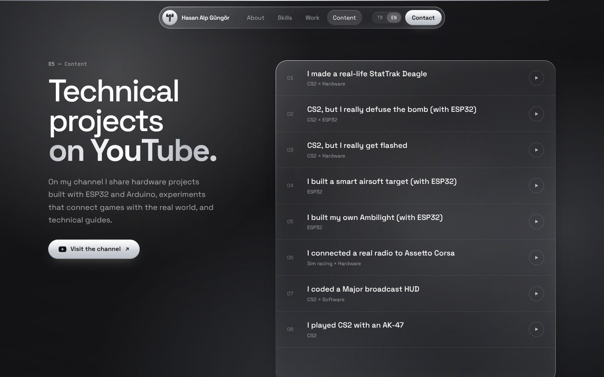

# Hasan Alp Güngör — Portfolio

My personal site and portfolio: who I am, my education, skills, projects and videos, with my logo rendered as real-time 3D liquid glass. Scroll and it turns, then comes apart piece by piece, and every piece is one of my skills.


## Highlights

- **Glass logo in 3D:** the logo is traced into polygons, split into seven pieces and extruded with three.js, then rendered with a refractive glass material (chromatic aberration and a slow liquid distortion).
- **Scroll story:** the logo starts intact, cracks along jagged lines as you scroll, then comes apart with a label pinned to each piece, turns around, and flies away.
- **Drag to spin** the logo in the hero, with inertia and a soft snap back.
- **My videos:** a selection from my YouTube channel, where I bring CS2 into real life with ESP32 builds.
- **My projects:** a pinned, horizontally scrolling gallery of my S26 Ultra, Buds4 Pro, Watch Ultra2 and Ring concept sites.
- **Turkish and English:** switch from the navbar; the choice is remembered.
- Liquid glass design: translucent, blurred surfaces with rim highlights over a slowly moving silver light, a floating capsule navbar and brushed silver accents.

## Screenshots

| | |
|---|---|
|  |  |
| **Skills:** every part is a technology | **...and it turns as you scroll** |
|  |  |
| **About** | **My projects** |
|  |  |
| **More work** | **Content** |

<p>
  
  
  
  
</p>

## Tech stack

- [Next.js 16](https://nextjs.org) (App Router), React 19, TypeScript
- [Tailwind CSS v4](https://tailwindcss.com)
- [three.js](https://threejs.org), [@react-three/fiber](https://github.com/pmndrs/react-three-fiber), [@react-three/drei](https://github.com/pmndrs/drei)
- [GSAP](https://gsap.com) ScrollTrigger and [Lenis](https://lenis.darkroom.engineering) smooth scrolling

## Run it

```bash
npm install
npm run dev
```

Open http://localhost:3000.

## Deploy

Import the repo on Vercel. Everything is detected automatically.

## Where things live

- `components/Logo.tsx` and `lib/logoShape.ts`: the 3D glass logo and its traced pieces
- `components/Scene.tsx`: the canvas, lighting and the scroll story (GSAP keyframes)
- `lib/data.ts`: projects, links and the skill for each logo piece
- `lib/i18n.ts`: Turkish / English switch

## Links

[GitHub](https://github.com/manyaksisko35) · [YouTube](https://www.youtube.com/@hasanalpgungor) · [itch.io](https://hasan-alp-gungor.itch.io/) · [LinkedIn](https://www.linkedin.com/in/hasan-alp-g%C3%BCng%C3%B6r-b1085131a/)
