# Hasan Alp Güngör — Portfolio

My personal site. It introduces me, my skills and my projects, with a real-time 3D game controller I modeled entirely in code (no downloaded 3D files). Scroll and it turns, then comes apart part by part, and every part is one of my skills.

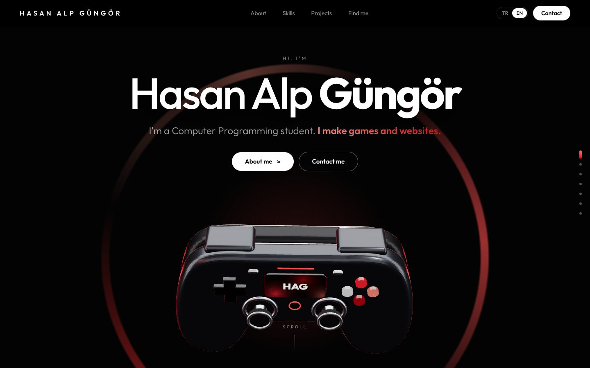

## Highlights

- **A controller built in code:** the shells, circuit board, glass screen, thumbsticks, d-pad, face buttons and bumpers are all generated with three.js (extruded bezier outlines and canvas textures).
- **Scroll story:** the controller moves aside for the intro, then explodes into layers with a label pinned to each part, turns around, and flies away.
- **Drag to spin** in the hero, with inertia and a soft snap back.
- **My projects:** a pinned, horizontally scrolling gallery of my S26 Ultra, Buds4 Pro, Watch Ultra2 and Ring concept sites.
- **Turkish and English:** switch from the navbar; the choice is remembered.
- Loader that draws the controller outline, section dots, scroll progress and ambient lighting per section.

## Screenshots

| | |
|---|---|
| 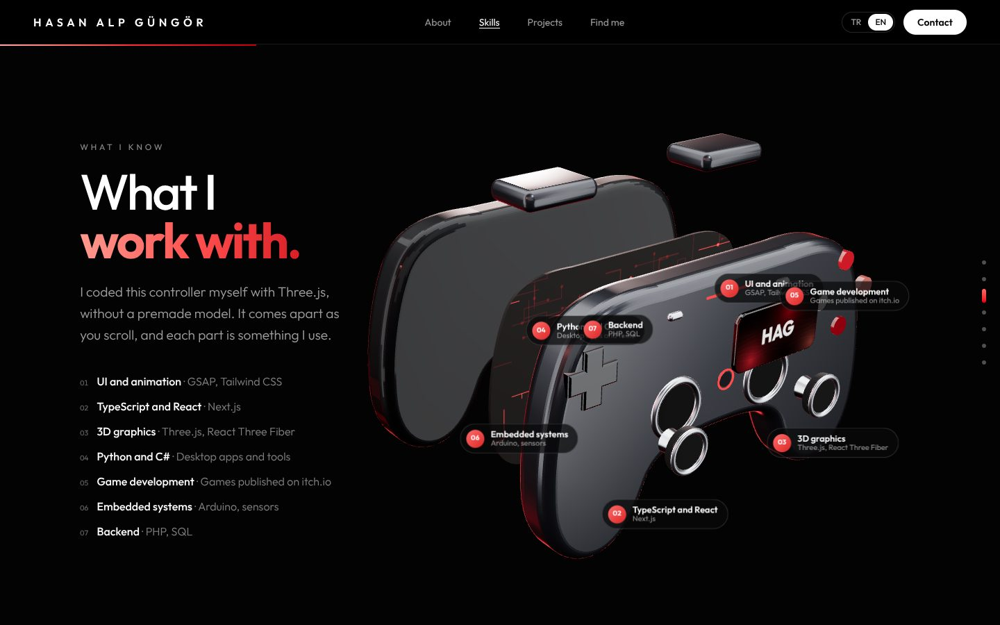 | 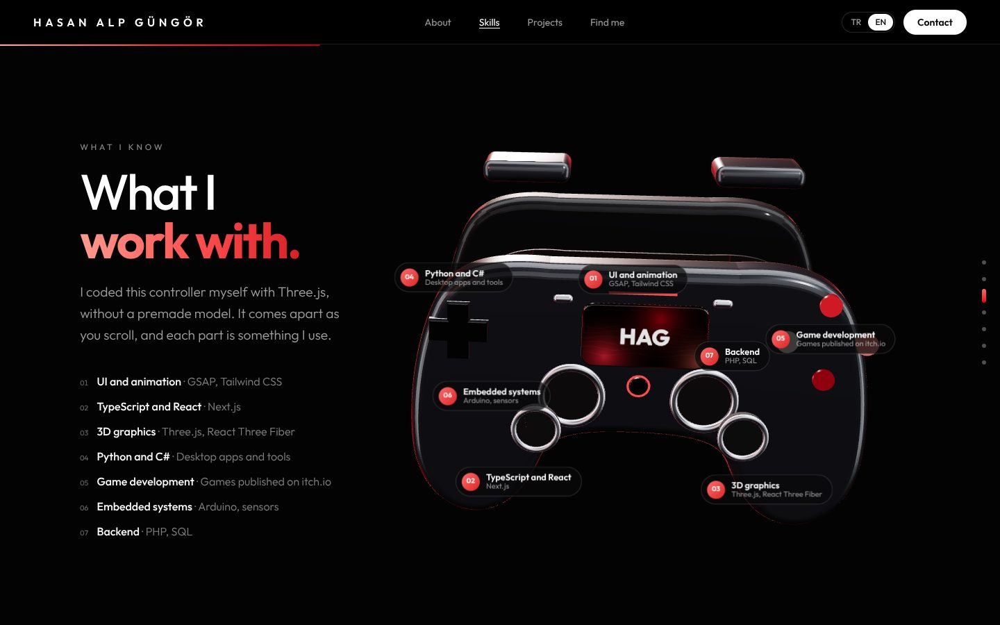 |
| **Teardown:** every part is a skill | **...and it turns as you scroll** |
| 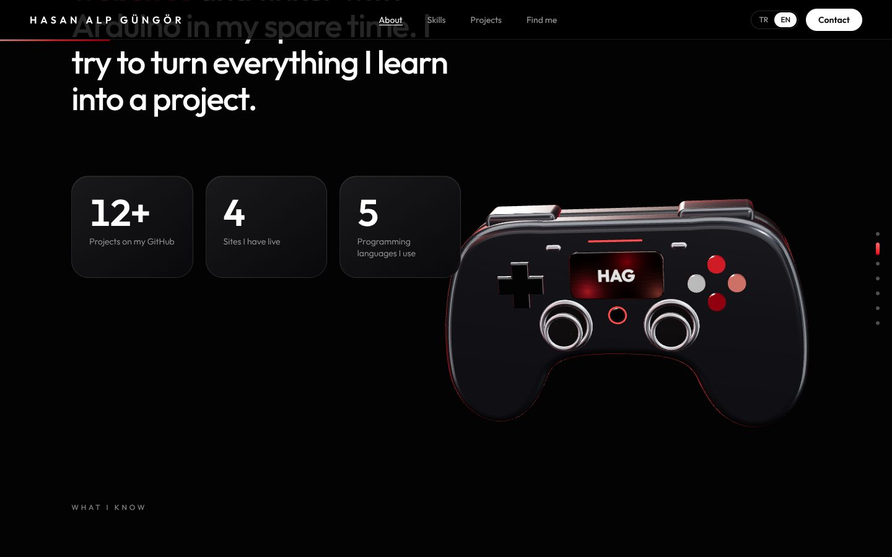 | 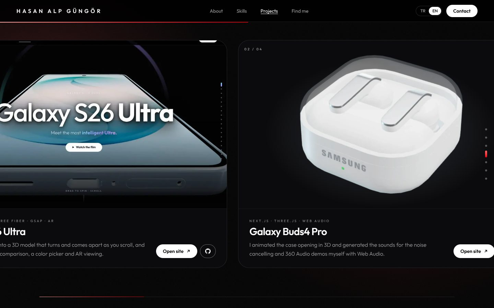 |
| **About** | **My projects** |
| 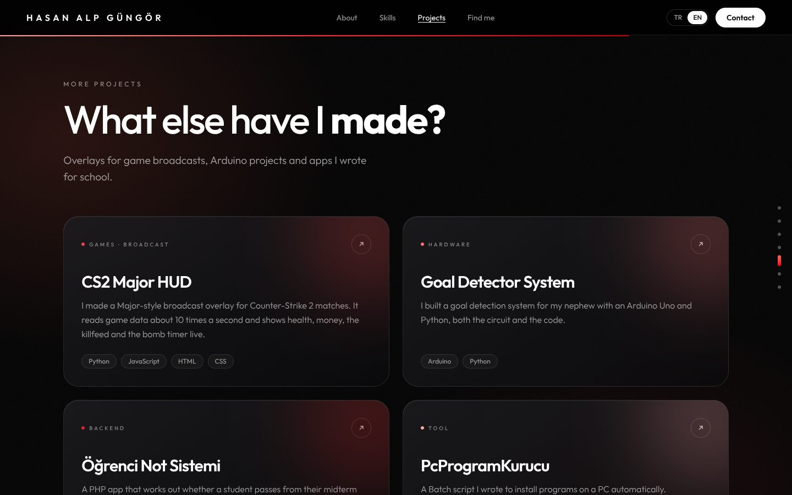 | 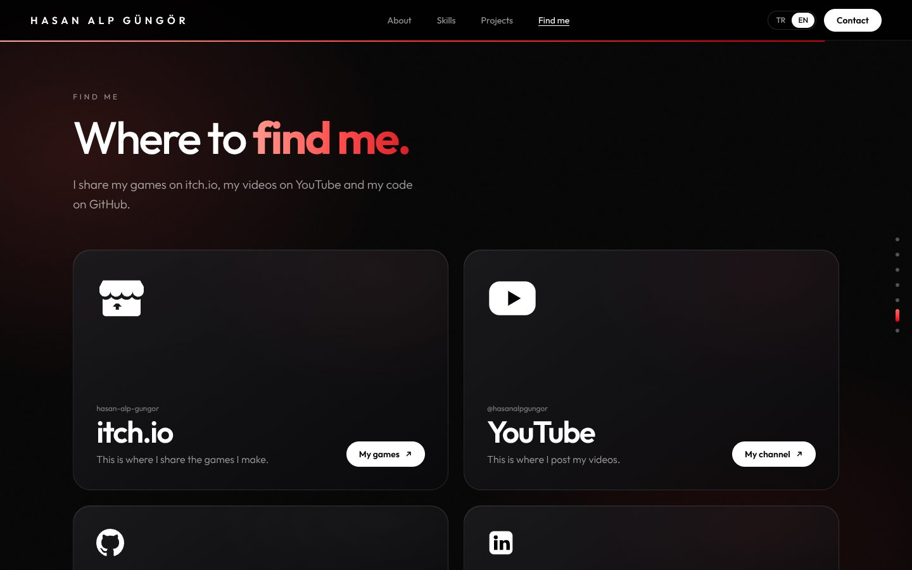 |
| **More work** | **Channels** |

<p>
  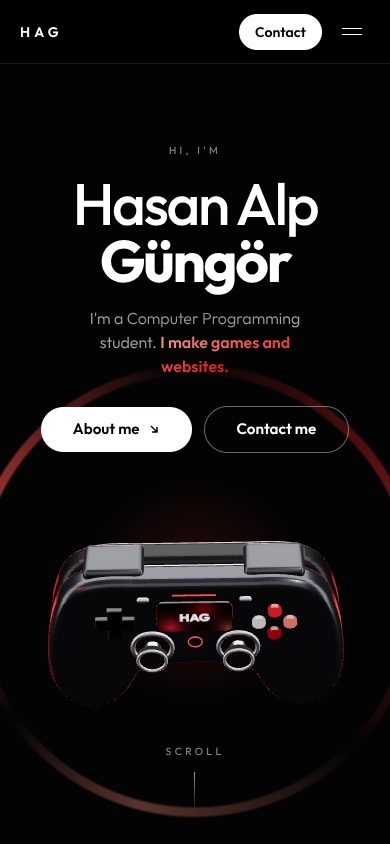
  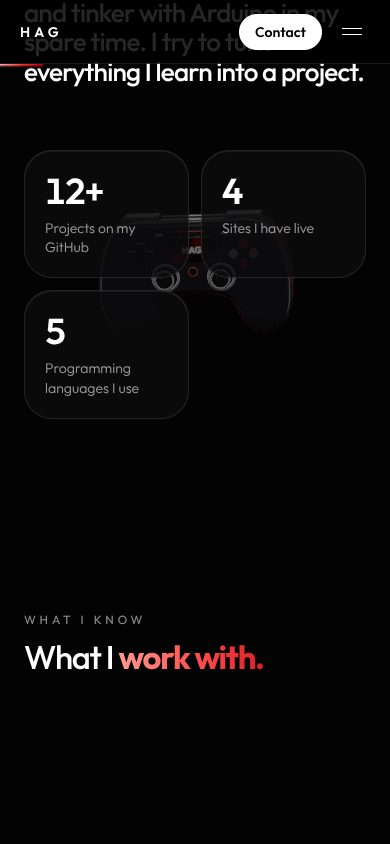
  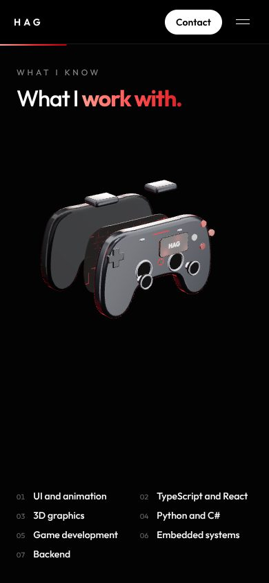
  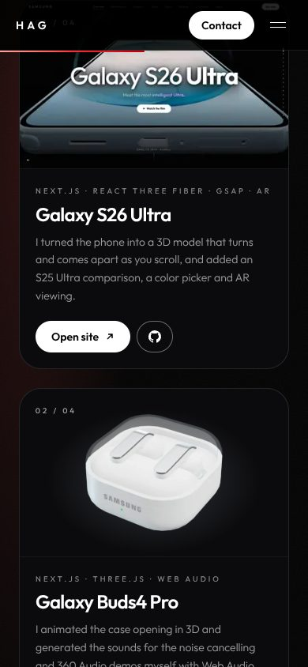
</p>

## Tech stack

- [Next.js 16](https://nextjs.org) (App Router), React 19, TypeScript
- [Tailwind CSS v4](https://tailwindcss.com)
- [three.js](https://threejs.org), [@react-three/fiber](https://github.com/pmndrs/react-three-fiber), [@react-three/drei](https://github.com/pmndrs/drei)
- [GSAP](https://gsap.com) ScrollTrigger and [Lenis](https://lenis.darkroom.engineering) smooth scrolling

## Run it

```bash
npm install
npm run dev
```

Open http://localhost:3000.

## Deploy

Import the repo on Vercel. Everything is detected automatically.

## Where things live

- `components/Controller.tsx` and `lib/controllerModel.ts`: the procedural controller
- `components/Scene.tsx`: the canvas, lighting and the scroll story (GSAP keyframes)
- `lib/data.ts`: projects, links and the skill for each controller part
- `lib/i18n.ts`: Turkish / English switch

## Links

[GitHub](https://github.com/manyaksisko35) · [YouTube](https://www.youtube.com/@hasanalpgungor) · [itch.io](https://hasan-alp-gungor.itch.io/) · [LinkedIn](https://www.linkedin.com/in/hasan-alp-g%C3%BCng%C3%B6r-b1085131a/)
